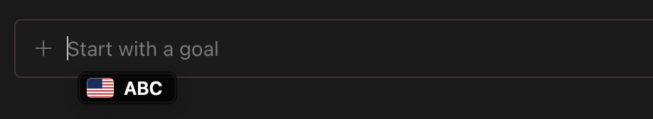

# CaretLang

A tiny macOS menu bar app that keeps a **flag + sample letters** of your current input source pinned right next to the text cursor — so you stop typing `ทำหยที` when you meant `hello`.



## Features

- Stays visible **the whole time a text field is focused**, following the caret as you type — not just a brief flash when you switch.
- Ignores the mouse. Disappears when you leave the text field.
- **Every language macOS supports**: the flag comes from the input source's language (via `Locale` region inference), with overrides for regional layouts (British → 🇬🇧, Canadian → 🇨🇦, Swiss → 🇨🇭 …). Sample letters come from the script (Latin `ABC`, Cyrillic `АБВ`, Arabic `ابت`, Devanagari `कखग`, …).
- **Terminals** (Ghostty, etc.) don't expose the caret position, so there the badge sits in the bottom-left corner of the terminal view.
- Chromium/Electron apps get their accessibility tree switched on automatically so the caret can be found.

## Install

### Download (easiest)

1. Download **CaretLang-x.y.z.zip** from the [latest release](https://github.com/realZnbest/CaretLang/releases/latest) and unzip it.
2. Drag **CaretLang.app** into **Applications**.
3. Open it. CaretLang isn't notarized by Apple (that needs a paid developer account), so macOS will block the first launch:
   - **macOS 15 and later:** click **Done**, then go to System Settings → Privacy & Security, scroll down and click **Open Anyway** next to *"CaretLang" was blocked*.
   - **macOS 14:** right-click the app → **Open** → **Open**.
   - Or from Terminal: `xattr -dr com.apple.quarantine /Applications/CaretLang.app`
4. Grant **Accessibility** permission when asked (System Settings → Privacy & Security → Accessibility → enable CaretLang). The badge appears as soon as it's granted.

Works on Apple silicon and Intel, macOS 14+.

### Build from source

Requires Xcode Command Line Tools (`xcode-select --install`).

```bash
git clone https://github.com/realZnbest/CaretLang.git
cd CaretLang
./build.sh --install   # builds and installs to ~/Applications
```

CaretLang registers itself as a login item on first launch. Toggle it from the menu bar icon → **Launch at Login**.

## Quit / Uninstall

Click the menu bar icon (the I-beam with a cursor):

- **Quit CaretLang** — stops it until next login.
- **Uninstall CaretLang…** — removes the login item and Accessibility permission, moves the app to the Trash, and quits.

## How it works

CaretLang listens for Accessibility notifications from the frontmost app (focus, selection and value changes, window moves) and for input-source changes, then asks for the focused element's selected text range and `AXBoundsForRange` and moves a borderless, click-through panel under the caret. A slow 0.5 s fallback covers apps that don't send notifications (and scrolling). Idle CPU is ~0%.

The app icon is generated by `swift tools/make-icon.swift`.

## Credits

Flag icons from [flag-icons](https://github.com/lipis/flag-icons) by Panayiotis Lipiridis (MIT) — see `Resources/flags/LICENSE-flag-icons`.

## License

MIT
